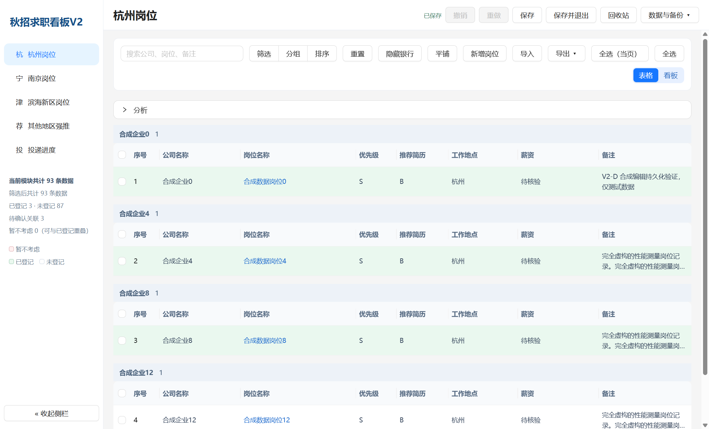
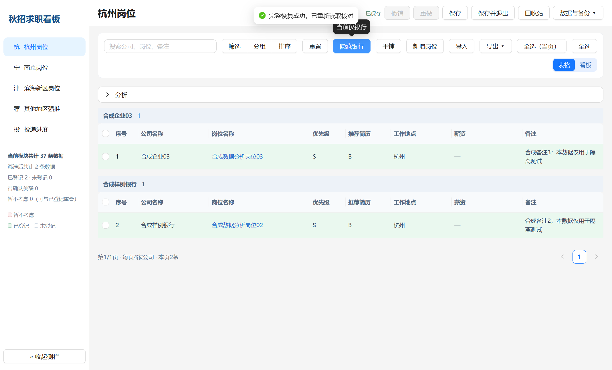
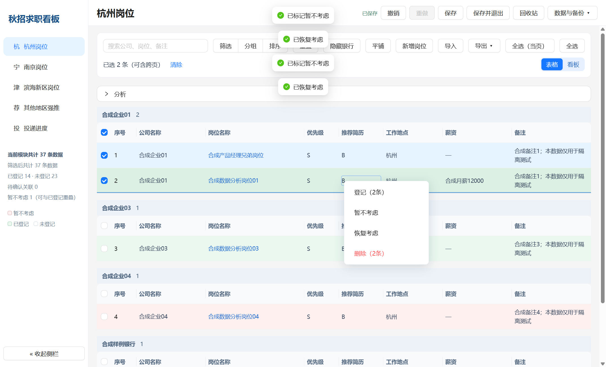
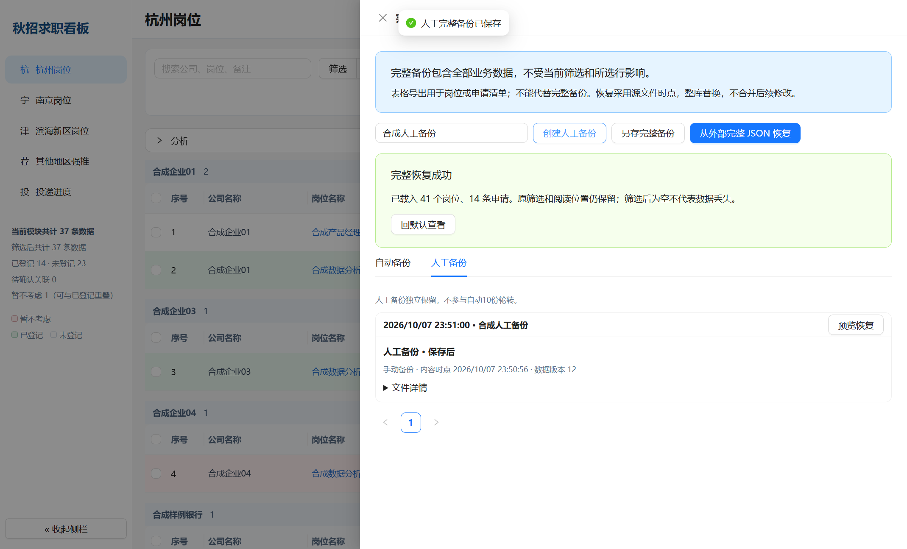

# 秋招求职看板 V2

**把岗位收集、投递记录和后续跟进放进同一个本地工作台。**

秋招过程中，岗位信息散落在招聘网站、Excel 和聊天记录里，投递、测评与面试状态又需要反复回填。本项目围绕这一实际使用问题，提供 Windows 桌面端的岗位与投递管理工具。

当前版本为 **2.0.0**，面向个人本机使用，作者已接受并用于日常求职管理。仓库提供源码、操作说明和合成示例；正式 EXE 在 [Releases](https://github.com/Roanldo7/career-board-v2/releases/tag/v2.0.0) 下载。

**第一次使用：** [下载成品](#使用成品) → [准备 CSV / Excel](docs/IMPORT.md) → 导入时检查字段映射 → 登记并跟进投递。

下图为隔离环境中的合成数据，不是作者的真实岗位或投递记录。首次下载成品不会自带图中数据。



## 数据如何导入：先看这里

**支持 `.csv`、`.xlsx`、`.xls`；表头不必完全一致，但自动识别只针对预设名称，不能识别的列需要手动映射。**

| 你的表头 | 初始自动识别结果 | 应如何操作 |
| --- | --- | --- |
| `公司名称`、`公司`、`企业`、`company_name` | 公司名称 | 检查映射即可 |
| **`企业名称`** | **暂不识别，默认忽略这列** | **在“字段映射”里手动选择“公司名称”，即可导入** |
| `岗位名称`、`职位名称`、`job_title` | 岗位名称 | 检查映射即可 |
| `职位`、`应聘岗位` | 暂不识别 | 手动选择“岗位名称” |
| `工作地点`、`地点`、`完整工作地点`、`location_text` | 完整工作地点 | 检查映射即可 |
| `城市` | 暂不识别 | 手动选择“完整工作地点” |

**最少只需三列，每行都要填写：**

| 公司名称 | 岗位名称 | 工作地点 |
| --- | --- | --- |
| 合成示例企业甲 | 合成需求分析岗位 | 杭州 |
| 合成示例企业乙 | 合成系统实施岗位 | 南京 |

下载 [最简 CSV 示例](examples/jobs-minimal.csv)，或者下载 [自定义表头示例](examples/jobs-custom-headers.csv) 练习手动映射。示例均为虚构数据；GitHub 显示表格时，可点击 **Raw / Download raw file** 下载原文件。

Excel 使用普通二维表：第一行为列名，第二行起一行一个岗位，不需要合并单元格或放标题大字。CSV 推荐使用 **UTF-8 编码**。同一 Excel 文件包含多个工作表时，在导入向导中选择一个工作表。

在目标岗位池点击 **导入**，按 **选择文件 → 预览与映射 → 数据校验 → 去重策略 → 最终确认** 操作。公司、岗位、地点没有映射或存在空值时会报错，补齐后才能确认。其他列可选；不需要的列选择“忽略此列”。

**岗位表导入只维护招聘信息，不会自动生成或覆盖“已投递／待面试”等投递进度。**迁移整套已有数据，应使用“数据与备份 → 备份与恢复 → 从外部完整 JSON 恢复”；任意 JSON、岗位表导出的 JSON 都不能直接当作完整备份。

详细的支持格式、字段表、日期／数字填写规则、重复处理和常见报错见 **[数据导入指南](docs/IMPORT.md)**。

## 主要功能

- **岗位与线索管理**：维护企业、岗位和待确认线索，集中整理招聘链接、地区、岗位方向等信息。
- **投递过程跟进**：登记投递，跟踪测评、面试及后续状态，支持同一企业的不同申请记录。
- **表格操作与筛选**：分页、排序、筛选、分组、批量选择和操作，支持“暂不考虑／恢复考虑”等个人决策标记。
- **导入与导出**：导入 CSV、XLSX 等岗位表格，通过字段映射与预览检查数据；按范围导出记录。
- **数据与备份**：本地 JSON 持久化、手动及自动备份、完整恢复预览与确认、回收站及部分操作撤销。
- **阅读与使用偏好**：保留筛选、页面与显示等使用偏好，减少重复设置。

项目不自动投递简历，也不保证录入的岗位仍然开放。招聘时效和申请结果以企业官方渠道为准。

### 筛选、登记与批量操作

搜索、筛选、分组和排序帮助缩小当前要处理的岗位范围。银行按钮可切换银行显示范围；勾选多条记录后右键，可选择登记、暂不考虑、恢复考虑或删除。登记表示在本软件中建立跟进记录，不会替你向招聘网站提交简历。





### 完整备份与恢复

“另存完整备份”用于迁移所有业务记录；普通表格导出适合整理清单。恢复采用备份时点的数据进行整库替换，先预览并确认，不能理解为与当前数据库自动合并。人工备份独立保留，不参与自动备份的 10 份轮转。



更多使用方法见 [功能图解](docs/FEATURES.md)。上面的功能截图复用 V2 隔离验证阶段的原图，部分标题文案与最终版略有不同，所示企业、岗位、备注和记录数量均为合成测试内容。

## 使用成品

在仓库的 **Releases → v2.0.0** 中下载 `CareerBoardV2-2.0.0-win-x64.exe`，双击启动。它与作者采用的 `秋招求职看板V2.exe` 为相同字节；英文附件名用于稳定下载。适用 Windows x64，当前成品未进行代码签名。

- 版本：`2.0.0`
- 成品类型：portable，原版静态启动提示面板
- 大小：`81,736,000` 字节
- SHA256：`f3dfa2b7bd4bc70254b8f2a1050852d64e9899ed1c66c93fd8959619856ddf51`

程序与业务数据分离，日常数据位于 `%APPDATA%\CareerBoardV2`。首次使用为空库；已有数据时继续读取现有库。需要迁移时，请区分“岗位表导入”和“完整 JSON 备份恢复”，不要把其中一种当作另一种。

静态启动面板提供启动过程提示，本身不代表程序加载时间已经缩短。

## 技术实现

| 层次 | 技术与职责 |
| --- | --- |
| 桌面容器 | Electron，主进程／预加载脚本／渲染进程分离 |
| 页面与交互 | React 18、TypeScript、Ant Design、Zustand |
| 构建 | Vite、esbuild |
| 数据 | 本地 JSON 文件、备份信封、版本迁移与恢复校验 |
| 表格处理 | SheetJS、Papa Parse |
| 校验 | TypeScript 类型检查、Node 测试运行器及合成测试数据 |

业务数据主要保存在本机。本项目没有接入 LLM，也不需要模型 API Key；它是个人求职管理工具。

## 本地开发

准备 Node.js 与 npm；建议使用 Node.js 24。原项目曾因不同 Node 环境出现兼容问题，具体可用性需以当前电脑实际安装和运行结果为准。

在仓库根目录执行：

```powershell
cd app
npm.cmd ci
npm.cmd run typecheck
npm.cmd run build
npm.cmd run preview:v2
```

开发预览默认使用仓库内 `work/author-trial/profile` 下的独立数据目录，不读取正式 `%APPDATA%\CareerBoardV2`。不要把这个预览目录当作正式数据维护位置。

运行源码中保留的 V2 单元测试：

```powershell
$env:CAREER_TEST_ROOT = Join-Path (Get-Location).Path ("..\work\V2B_HF01_" + (Get-Date -Format "yyyyMMdd_HHmmss"))
$env:V2B_TEST_WORK = Join-Path $env:CAREER_TEST_ROOT "inherited"
npm.cmd test
```

恢复测试要求显式指定上述合成数据目录，目录名称中的 `V2B_HF01_日期_时间` 用于避免测试误写其他位置。

本次整理没有重新打包成品。原版打包链依赖旧工作区中的专用工具与缓存，因此仓库副本移除了 `package.json` 里的旧 `dist:v2` 快捷命令；`electron-builder.yml` 仅保留原有配置作参考。上述开发命令不等于已验证的跨机器成品重建流程。

## 目录

```text
app/
  src/                React 页面、状态、领域类型和展示逻辑
  electron/           桌面主进程、IPC 与数据服务
  resources/          数据结构与字段映射定义
  scripts/            构建、预览与测试入口
  tests/              V2 单元测试及合成测试数据
  vendor/             锁定的第三方依赖分发包
  build-resources/    应用图标等资源
docs/
  IMPORT.md           文件格式、字段命名、映射与导入步骤
  FEATURES.md         主要功能图解
  PRIVACY.md          本次公开前的数据范围核查说明
  images/             经过查看的合成数据截图
  PROJECT.md          项目背景、责任分工与版本说明
examples/
  jobs-minimal.csv          最少三列示例
  jobs-custom-headers.csv   手动映射示例
```

## 开发与责任分工

作者负责实际求职场景与需求提出、功能取舍、使用流程、试用反馈和验收；Codex 协助代码实现、调试、测试及打包。仓库保留这一协作边界，不将 AI 协作实现表述为作者独立完成全部编码。

## 资料范围

仓库包含 V2 源码、依赖锁、必要资源和合成测试数据；不包含个人投递数据库、备份、真实求职表格、简历、历史研究材料、运行缓存、`node_modules` 或原项目 Git 历史。成品 EXE 单独存放于 Release。

公开前已检查源码快照和 EXE 内部应用包，确认不包含作者的真实岗位、申请或个人业务 JSON。仓库中的 JSON 为依赖、类型及字段定义等配置文件，不能等同于个人数据库。截图和导入示例也只使用合成数据。核查范围见 [数据与隐私说明](docs/PRIVACY.md)。

第三方版权与许可说明保留在 [`app/THIRD_PARTY_NOTICES.txt`](app/THIRD_PARTY_NOTICES.txt)。当前未为本项目新增开源许可证。
